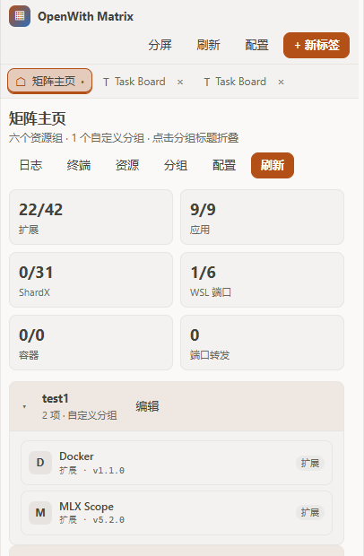

<div align="center">

# OpenWith Matrix

**A browser-style multi-tab workspace inside [OpenChamber](https://openchamber.dev).**
One panel for guest extensions, Windows apps, ShardX profiles, WSL2 services,
Docker, Kubernetes and the links you open every day.

English · [简体中文](./README.zh-CN.md)

[](./LICENSE)
[](https://openchamber.dev)



</div>

OpenWith Matrix turns the extension side panel into a small tabbed workspace.
Instead of switching between separate tools, you keep the project, the services
around it, and the links you need in one place — with tabs, split view and
pinned pages that survive a reload.

> Built as an OpenChamber **extension** (panel + local service), not an OpenCode
> plugin.

## Contents

- [Features](#features)
- [How it works](#how-it-works)
- [Install](#install)
- [Usage](#usage)
- [Resource management](#resource-management)
- [Configuration](#configuration)
- [Permissions](#permissions)
- [Limitations](#limitations)
- [Development](#development)
- [Timeline](#timeline)
- [Documentation](#documentation)
- [License](#license)

## Features

- **Tab OS** — five tab kinds (home, guest extension, web page, log stream,
  terminal), keep-alive, pinning, drag reorder, and a persistent layout.
- **Split view** — put a second tab next to the current one, switch direction,
  drag the divider, double-click to reset.
- **Extensions group** — discover installed OpenChamber guests, enable, hide or
  uninstall them, and embed a guest's panel in a tab with a host-issued frame
  grant.
- **Extension marketplace** — browse the official directory and GitHub community
  projects in one place, grouped by category, with stars, last update and
  repository links; manifests the host accepts install with one click. The
  catalog is cached on disk, so restarts open instantly and refresh in the
  background.
- **Windows apps and ShardX** — launch any local `.exe` or PATH command with the
  current project appended, and start/stop ShardX profiles.
- **WSL2 group** — list distributions, resolve the WSL IP, and open configured
  ports as local web pages.
- **Docker group** — run compose up/down/ps/restart and inspect containers.
- **Kubernetes group** — choose a context, list pods, and create or stop port
  forwards.
- **Cloud bookmarks and webhooks** — URL and body templates with
  `{path}`, `{winPath}`, `{pathUrlEncode}`, `{projectName}`, `{gitBranch}` and
  `{wslIp}`.
- **Matrix home** — configurable resource tabs with editable labels, drag
  ordering, per-tab list/card/compact views and pagination; tabs can be hidden,
  deleted and restored, wrap on narrow panels, and custom groups get their own
  tab.
- **Layered actions** — workspace actions (split, refresh, settings, new tab)
  stay in the top bar; home tabs, resources and groups live in one “Manage” menu;
  the new-tab menu lists every enabled extension with its icon and version, with
  URL, logs and terminal entries underneath. On narrow panels the brand name
  collapses and the two menus switch with one click.
- **Resource management** — one dialog over all 11 default sections: extensions,
  Windows apps, ShardX instances, WSL distros and ports, compose files,
  containers, kube contexts, port forwards, bookmarks and webhooks.
- **Any local executable** — the “Pick EXE” button opens the native Windows file
  dialog and fills the application name from the file name.
- **Terminal and logs** — interactive PowerShell/cmd/WSL/bash sessions, and log
  streams from files, commands or URLs, with “send to AI”.
- **Local by design** — the service listens on loopback only and every request
  carries the host-issued bearer token.

## How it works

The panel is a sandboxed iframe: it cannot touch the filesystem, start a process
or embed an arbitrary site. A small Node service, started by OpenChamber, does
the privileged work.

```text
panel iframe ──serviceRequest──► OpenChamber host ──127.0.0.1:PORT──► service
                                                                    ├─ apps, WSL, Docker, kubectl, Chrome
                                                                    ├─ config + logs
                                                                    └─ guest host API
```

- **Guest tabs** use a host `frame-grant` and a small shim, so another
  extension's UI can run inside a Matrix tab.
- **Web tabs** are rendered by a headless Chrome/Edge through CDP; the panel
  only shows frames and forwards input.
- **Terminal, log and browser panes** poll the service with incremental cursors.

The full module map and API table are in [docs/ARCHITECTURE.md](./docs/ARCHITECTURE.md).

## Install

OpenChamber **2.0.0 or newer**, web or desktop.

1. Open **Settings → Extensions**.
2. Add one of:
   - the latest zip:
     `https://github.com/wbi35772/openchamber-openwith-matrix/releases/latest/download/openchamber-openwith-matrix-latest.zip`
   - the `dist/` folder of a local clone after `npm run build`;
   - the git URL of the `release` branch:
     `https://github.com/wbi35772/openchamber-openwith-matrix.git#release`
     (git installs can update in place when `package.json` version increases).
3. Approve **Allow and enable**. The dialog lists the local service and the
   commands it may run.

Folder installs are best for development: edit, `npm run build`, reload the
panel.

## Usage

Open **OpenWith Matrix** from the extension rail. The home tab is a tab bar of
resource views:

| Tab | What it does |
| --- | --- |
| Extensions | enable, hide, open or embed installed guests |
| Marketplace | browse official and community extensions; install with one click |
| Windows apps & ShardX | launch apps with the project directory; start/stop ShardX |
| WSL2 | show distros and IP; open configured ports |
| Docker | compose actions and container state |
| Kubernetes | contexts, pods, port forwards |
| Cloud | bookmarks and webhooks, with path/branch/WSL variables |

Click a tab to swap the panel below it; drag a tab to reorder. **Tabs** opens the
label editor, where each tab can be renamed, hidden, reordered, deleted or
switched between list, card and compact views. Deleted tabs, including built-ins,
stay in the editor under **Deleted tabs** and can be restored. Use **Resources**
to edit any default group, and **Groups** to arrange custom home groups; each
custom group automatically gets its own tab.

Tabs:

- **+ New tab** lists every enabled extension with its icon and version, plus
  web, log and terminal entries.
- Drag a tab to reorder; use the pin control to keep it.
- **Split** opens a second pane; drag the divider to resize, double-click to
  reset to 50/50.
- Layout and tabs are restored from host storage after a reload.

## Resource management

The **Resources** dialog edits the shipped groups without editing JSON:

- **Extensions** — show/hide and reorder installed guests.
- **Windows apps** — name, command, arguments; **Pick EXE** opens the native
  file dialog; the project directory is appended at launch.
- **ShardX** — instance name, profile, folder.
- **WSL** — distributions and quick ports (HTTP/HTTPS/TCP).
- **Docker** — compose files and container names.
- **Kubernetes** — contexts and preset port forwards.
- **Cloud** — bookmarks and webhooks, including headers and body templates.

Changes are saved with a deep merge: objects merge, arrays replace. The file is
written atomically to
`~/.config/openchamber/openwith-matrix.json`
(`%USERPROFILE%\.config\openchamber\openwith-matrix.json` on Windows).

## Configuration

The configuration reference covers every field and default:
[docs/CONFIG.md](./docs/CONFIG.md).

Most used settings:

| Setting | Default | Meaning |
| --- | --- | --- |
| `settings.maxTabs` | `40` | tab limit |
| `settings.keepAliveTabs` | `12` | kept-alive tabs |
| `settings.terminalShell` | `powershell` | default terminal |
| `settings.browser.chromePath` | Chrome path | headless browser |
| `settings.shardx.launcherPath` | empty | ShardX launcher; set it before “Launch browser” |
| `home.pageSize` | `8` | items per card page |

Supported variables: `{path}`, `{winPath}`, `{pathUrlEncode}`,
`{projectName}`, `{gitBranch}`, `{wslIp}`.

## Permissions

| Capability | Why |
| --- | --- |
| `service` | the local service reads config/logs and runs approved commands with your user rights |

`permissions.exec` lists every command the service may start (`open`,
`powershell`, `wsl`, `docker`, `kubectl`, `git`, Chrome/Edge, ShardX and the
configured app launchers). Adding a new external command means updating that
list and re-approving the extension.

The service binds `127.0.0.1` only, rejects requests without the host token, and
caps request bodies at 2 MB.

## Limitations

- **Windows-first** — ShardX, Windows apps and WSL2 groups require Windows;
  other platforms keep tabs, terminal, logs, guest and web features.
- **Service approval is required** — without it the panel can only render.
- **External tools are optional** — Docker, kubectl and Chrome/Edge must be
  installed for their groups/tabs to work.
- **ShardX launcher is not shipped** — set `settings.shardx.launcherPath`.
- **Frame grants expire** — reload a guest tab to request a new grant.
- **No automated end-to-end suite yet** — regression follows the checklist in
  [docs/BASELINE.md](./docs/BASELINE.md).
- **Not available in VS Code or mobile** — extensions load only in OpenChamber.

## Development

```bash
npm install
npm run typecheck
npm run build        # dist/
npm test             # typecheck + build
```

Requirements: Node 20+, npm 10+, Bun 1.3.x (used by the SDK bundler). Install
`dist/` as a folder extension, rebuild after each change, and reload the panel.

`dist/` is generated and never committed. Pushing to `main` runs the release
workflow: type-check, build, zip, refresh the orphan `release` branch and publish
the rolling `latest` Release. See [docs/DEVELOPMENT.md](./docs/DEVELOPMENT.md).

## Timeline

| Date | Milestone |
| --- | --- |
| 2026-10-13 | First release: a side-panel launcher for extensions, apps and links |
| 2026-11-05 | 2.0.0 baseline: tab workspace, split view, config v4, 11 resource sections |
| 2026-11-06 | Tabbed home, layered actions, editable/deletable built-in tabs, hierarchical resource navigation |

Every change is listed in [changelog.md](./changelog.md).

## Documentation

- [Changelog](./changelog.md) — every change, newest first
- [Baseline](./docs/BASELINE.md) — scope, invariants, verification record
- [Architecture](./docs/ARCHITECTURE.md) — runtime, panel, service, routes
- [Configuration](./docs/CONFIG.md) — every field, default and variable
- [Development](./docs/DEVELOPMENT.md) — build, debug, release
- [v1 design archive](./docs/design/v1-open-with-proposal.md)

## License

[Apache-2.0](./LICENSE). Brand names and marks belong to their owners.
