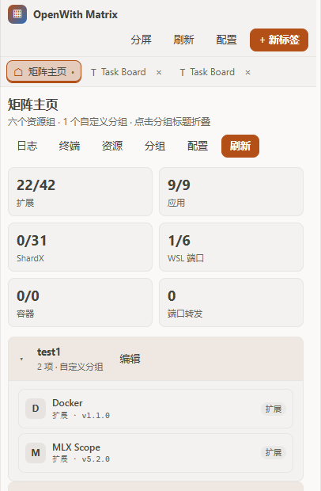

<div align="center">

# OpenWith Matrix

**把 [OpenChamber](https://openchamber.dev) 的侧栏变成多标签工作台。**
扩展、Windows 应用、ShardX、WSL2、Docker、Kubernetes 和常用链接，都收在一个面板里。

[English](./README.md) · 简体中文

[](./LICENSE)
[](https://openchamber.dev)



</div>

OpenWith Matrix 把扩展侧栏变成一个小型的标签式工作台。项目、项目周边的服务、以及每天
要打开的链接都在同一处，标签、分屏和置顶页面在刷新后仍然保留。

> 这是一个 OpenChamber **扩展**（面板 + 本地服务），不是 OpenCode 插件。

## 目录

- [功能](#功能)
- [工作原理](#工作原理)
- [安装](#安装)
- [使用](#使用)
- [资源管理](#资源管理)
- [配置](#配置)
- [权限](#权限)
- [限制](#限制)
- [开发](#开发)
- [时间线](#时间线)
- [文档](#文档)
- [许可证](#许可证)

## 功能

- **标签页工作台** — 五种标签（主页、扩展、网页、日志、终端）、保活、置顶、拖动排序、
  布局持久化。
- **分屏** — 主副两个标签并排，切换方向，拖动分割线，双击恢复 50/50。
- **扩展组** — 发现已安装 guest，启用、隐藏或卸载，并通过宿主签发的 frame grant 在标签内
  嵌入其他扩展的界面。
- **扩展市场** — 汇总官方目录与 GitHub 社区扩展，按分类展示，卡片带星标、最近更新和
  仓库链接；清单合法的扩展可一键安装。目录会缓存到本地磁盘，重启后立即打开并在后台刷新。
- **Windows 应用与 ShardX** — 用任意本机 `.exe` 或 PATH 命令打开当前项目，启动/停止
  ShardX 实例。
- **WSL2 组** — 发行版列表、WSL IP、配置好的端口一键打开。
- **Docker 组** — compose 启停/状态/重启，容器列表。
- **Kubernetes 组** — 选择 context、查看 pod、建立或停止端口转发。
- **云书签与 Webhook** — URL 与请求体支持 `{path}`、`{winPath}`、`{pathUrlEncode}`、
  `{projectName}`、`{gitBranch}`、`{wslIp}`。
- **矩阵主页** — 可配置资源标签：标签可改名、拖拽排序、隐藏、删除和恢复，每个标签可切换列表/卡片/紧凑视图，窄面板下自动换行，自定义分组自动生成标签。
- **动作分层** — 顶栏只保留工作区动作（分屏、刷新、配置、新标签）；主页标签、默认资源和自定义分组收进“管理”菜单；“新标签”菜单列出全部已启用扩展及其图标、版本，网址与日志/终端入口收在列表下方；窄面板下品牌名收起，两个菜单可一键切换。
- **资源管理** — 一个弹窗覆盖 11 个默认分区：扩展、Windows 应用、ShardX、WSL 发行版、
  WSL 端口、Compose 文件、容器、Kube Context、端口转发、云书签、Webhook。
- **任意本机 EXE** — 点击「选择 EXE」打开系统文件对话框，自动用文件名填入应用名称。
- **终端与日志** — PowerShell/cmd/WSL/bash 交互会话；文件、命令或 URL 日志流，可发送到 AI。
- **本地优先** — 服务只监听回环地址，每个请求都带宿主签发的 Bearer token。

## 工作原理

面板运行在沙箱 iframe 中：不能直接访问文件系统、启动进程或嵌入任意外部网站。由
OpenChamber 启动的本地 Node 服务负责所有特权操作。

```text
panel iframe ──serviceRequest──► OpenChamber host ──127.0.0.1:PORT──► service
                                                                    ├─ 应用、WSL、Docker、kubectl、Chrome
                                                                    ├─ 配置与日志
                                                                    └─ guest 宿主 API
```

- **guest 标签**：宿主签发 frame grant，注入很小的 shim，让其他扩展的界面在标签内运行。
- **网页标签**：由服务端无头 Chrome/Edge 通过 CDP 渲染，面板只显示帧并转发输入。
- **终端、日志、浏览器**：面板按增量游标轮询服务。

完整模块划分与接口表见 [docs/ARCHITECTURE.md](./docs/ARCHITECTURE.md)。

## 安装

需要 OpenChamber **2.0.0 或更新版本**（网页版或桌面版）。

1. 打开 **设置 → 扩展**。
2. 添加以下任一来源：
   - 最新 zip：
     `https://github.com/wbi35772/openchamber-openwith-matrix/releases/latest/download/openchamber-openwith-matrix-latest.zip`
   - 本地克隆执行 `npm run build` 后的 `dist/` 文件夹；
   - `release` 分支的 git 地址：
     `https://github.com/wbi35772/openchamber-openwith-matrix.git#release`
     （`package.json` 版本增加后，git 安装可原地更新）。
3. 批准 **Allow and enable**。弹窗会列出本地服务与允许执行的命令。

开发时建议用文件夹安装：修改源码 → `npm run build` → 刷新面板。

## 使用

从扩展侧栏打开 **OpenWith Matrix**。主页是一排资源标签：

| 标签 | 作用 |
| --- | --- |
| 扩展 | 启用、隐藏、打开或嵌入已安装 guest |
| 扩展市场 | 浏览官方与社区扩展，合法清单一键安装 |
| Windows 应用与 ShardX | 用当前项目目录启动应用；启停 ShardX |
| WSL2 | 发行版、IP、端口快捷入口 |
| Docker | compose 操作与容器状态 |
| Kubernetes | context、pod、端口转发 |
| 云 | 书签与 Webhook，支持路径/分支/WSL 变量 |

点击标签切换下方内容区，拖动标签调整顺序。**标签** 打开标签编辑器，可改名、隐藏、
排序、删除，并为每个标签选择列表、卡片或紧凑视图；删除的内置标签会留在编辑器底部的
“已删除的标签”里，可随时恢复。**资源** 编辑默认分组，**分组** 编排主页自定义分组；
每个自定义分组会自动生成一个标签。

标签页：

- **+ 新标签** 列出全部已启用扩展（图标、名称、版本），并提供网页、日志、终端入口。
- 拖动标签调整顺序；置顶后不会被自动回收。
- **分屏** 打开副窗格；拖动分割线调整比例，双击恢复 50/50。
- 刷新后从宿主存储恢复标签与布局。

## 资源管理

**资源** 弹窗可以直接编辑随扩展发布的分组，不必手写 JSON：

- **扩展** — 显示/隐藏、排序。
- **Windows 应用** — 名称、命令、参数；**选择 EXE** 打开系统文件对话框；启动时自动追加
  当前项目目录。
- **ShardX** — 实例名、profile、文件夹。
- **WSL** — 发行版与快捷端口（HTTP/HTTPS/TCP）。
- **Docker** — Compose 文件与容器名。
- **Kubernetes** — context 与预置端口转发。
- **云** — 书签与 Webhook，含请求头与请求体模板。

保存采用深合并：对象逐层合并，数组整体替换。文件原子写入
`~/.config/openchamber/openwith-matrix.json`
（Windows 为 `%USERPROFILE%\.config\openchamber\openwith-matrix.json`）。

## 配置

完整字段与默认值见 [docs/CONFIG.md](./docs/CONFIG.md)。

常用设置：

| 设置 | 默认值 | 含义 |
| --- | --- | --- |
| `settings.maxTabs` | `40` | 标签上限 |
| `settings.keepAliveTabs` | `12` | 保活标签数 |
| `settings.terminalShell` | `powershell` | 默认终端 |
| `settings.browser.chromePath` | Chrome 路径 | 无头浏览器 |
| `settings.shardx.launcherPath` | 空 | ShardX 启动器；使用「启动浏览器」前必须填写 |
| `home.pageSize` | `8` | 每页条数 |

可用变量：`{path}`、`{winPath}`、`{pathUrlEncode}`、`{projectName}`、`{gitBranch}`、
`{wslIp}`。

## 权限

| 能力 | 用途 |
| --- | --- |
| `service` | 本地服务读取配置/日志，并以你的用户权限执行已批准的命令 |

`permissions.exec` 列出服务可启动的全部命令（`open`、`powershell`、`wsl`、`docker`、
`kubectl`、`git`、Chrome/Edge、ShardX 以及配置的应用启动器）。新增外部命令时，必须
同步修改该列表并重新批准扩展。

服务只绑定 `127.0.0.1`，拒绝没有宿主 token 的请求，请求体上限 2 MB。

## 限制

- **Windows 优先** — ShardX、Windows 应用与 WSL2 组依赖 Windows；其他平台保留标签、
  终端、日志、guest 与网页能力。
- **必须批准服务** — 未批准时面板只能渲染静态界面。
- **外部工具可选** — Docker、kubectl、Chrome/Edge 未安装时，对应分组或标签不可用。
- **不附带 ShardX 启动器** — 需填写 `settings.shardx.launcherPath`。
- **frame grant 会过期** — 重新打开 guest 标签以申请新授权。
- **暂无自动化端到端测试** — 回归按 [docs/BASELINE.md](./docs/BASELINE.md) 的清单执行。
- **VS Code 与移动端不可用** — 扩展只在 OpenChamber 中加载。

## 开发

```bash
npm install
npm run typecheck
npm run build        # dist/
npm test             # typecheck + build
```

环境：Node 20+、npm 10+、Bun 1.3.x（SDK 打包器使用）。把 `dist/` 作为文件夹扩展安装，
每次修改后重新构建并刷新面板。

`dist/` 由构建生成，不提交。推送到 `main` 会触发发布工作流：类型检查、构建、打包、
更新孤立 `release` 分支并发布滚动 `latest` Release。详见
[docs/DEVELOPMENT.md](./docs/DEVELOPMENT.md)。

## 时间线

| 日期 | 里程碑 |
| --- | --- |
| 2026-10-13 | 首个版本：扩展、应用与链接的侧栏启动器 |
| 2026-11-05 | 2.0.0 基线：标签工作台、分屏、配置 v4、11 个资源分区 |
| 2026-11-06 | 标签化主页、动作分层、内置标签可编辑删除、资源导航层级 |

逐条变更见 [changelog.md](./changelog.md)。

## 文档

- [变更记录](./changelog.md) — 逐条变更，最新在前
- [基线](./docs/BASELINE.md) — 范围、不变量、验证记录
- [架构](./docs/ARCHITECTURE.md) — 运行模型、面板、服务、路由
- [配置](./docs/CONFIG.md) — 全部字段、默认值与变量
- [开发](./docs/DEVELOPMENT.md) — 构建、调试、发布
- [v1 设计稿存档](./docs/design/v1-open-with-proposal.md)

## 许可证

[Apache-2.0](./LICENSE)。品牌名称与标识归各自所有者。
